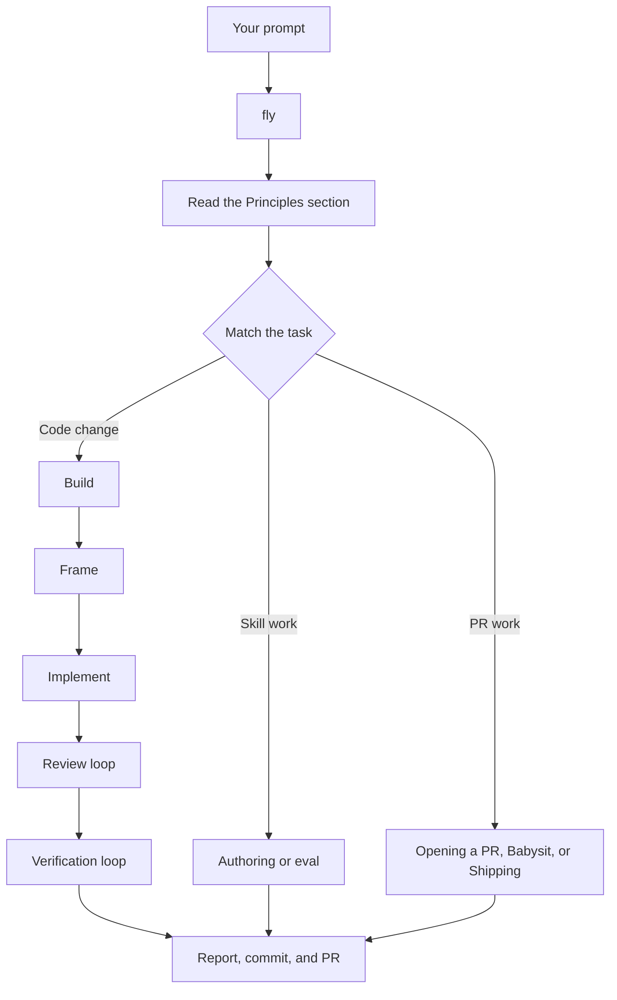

# Route work through `/fly`

`/fly` is the front door. Give it a goal. It uses Build for code changes and a focused playbook for authoring, eval, PRs, or shipping. It copies the playbook's steps into the todo list and calls other skills as needed. In this page you learn what a good prompt looks like, and how little of one you actually need.

## What happens to your prompt



Build covers features, bug fixes, refactors, performance changes, UI work, migrations, and long tasks. Its review and verification loops each stop after three rounds if findings remain open. The [playbook directory](../../skills/fly/playbooks/) also contains authoring-a-skill, eval, babysit, shipping, and opening-a-pr.

Read-only questions use the relevant skill, such as `/how`, `/why`, or `/recall`, and respect a request to leave code untouched.

## Say the goal, not the ceremony

You don't write a spec. You say what's wrong or what you want, plus anything you already know that saves the agent time:

```text
/fly users get two notifications after a retry. repro first, then fix and verify.
```

That's a Build prompt. "repro first" is a real constraint, and framing a bug requires a reproduction on the real surface. Watch the todo list fill with Build's steps. A skipped step stays visible with `skip: <reason>`.

## What goes in a prompt

A useful prompt carries up to five things, and each one fits in a sentence:

- **The goal.** Say what's wrong, or what you want.
- **The done check.** It must be able to pass or fail. "Make it better" and "work on it for an hour" aren't checks.
- **The proof you want to see.** Ask for the real command output, a video of the flow, the stored value, or a before-and-after number.
- **What you already know.** A symptom, a repro step, a log line, or a link saves the agent a search.
- **The real constraints.** "repro first", "don't change any code yet", "zero behavior change", and "let me review before proceeding" each change what the agent does.

Here's one prompt with all five:

```text
/fly the csv export drops its last row since yesterday's deploy. failing job id is 4812. repro first, then fix. done means the 60k-row fixture exports every row. show me the row counts before and after.
```

Two things are worth leaving out:

- **The how.** Say what to achieve, and leave the agent room to find a better path than the one you'd pick. The same goes for a list of skills, covered in the pitfall below.
- **Your theory of the cause, at first.** A stated guess narrows the search to wherever you pointed. Let the agent restate the problem before you share your hunch.

For a noisy report, such as a long thread or a vague bug, make the restatement the first step:

```text
/fly read this thread. restate the underlying issue in your own words, in plain english. don't change any code yet.
```

A misreading shows up in the restatement, before any code exists. Correct it there, and it costs you one message instead of one wrong fix.

## Follow up short

When the conversation already carries the context, the prompt shrinks to almost nothing. All of these are enough:

```text
/fly do it
```

```text
continue
```

```text
keep going until done
```

Short works because the playbook holds the structure, and `/fly` stays in context when you start each prompt with it or name it in the repository's `AGENTS.md` or `CLAUDE.md`. [Set up fly](./01-setup.md#run-your-first-task) shows both. Your words carry the intent, and the skill carries the rigor.

## Switch tasks with "new task"

A long chat accumulates context from the last task. When you change subjects, say so:

```text
/fly new task. figure out why the cache entry survives logout. don't change any code yet.
```

"new task" tells `/fly` to re-match rather than continue the prior task. "don't change any code yet" keeps this one read-only. Without those two phrases, an agent building a feature may treat your question as the next implementation step.

## Give parallel work its own worktree

If you run several agents against one repository in one working tree, they will fight over the files, the ports, and the build output. Isolation means a git worktree. A subagent gets one with `isolation: "worktree"` on the `Agent` tool in Claude Code, and a separate top-level thread gets one through `t3_thread_launch` with a worktree strategy in T3 Code, which works for Claude Code and Codex threads alike. Each gets its own branch and checkout, so it can install dependencies and run your app without touching the others.

Ask for the worktree up front when the base matters:

```text
/fly new task. branch off <base> in a fresh worktree, then port the parser change there.
```

Each task in its own branch and worktree means no agent stomps another's files. Worktrees cost disk and machine resources, so a laptop runs only a handful at once. The [Opening a PR playbook](../../skills/fly/playbooks/opening-a-pr.md) already works from a worktree for code changes, so mostly you only say this when a specific base or location matters.

## Let it merge with `/fly auto`

Plain `/fly` commits, pushes, and opens the PR, then stops. It merges or deploys only when you ask, as in "land the stack". Put `auto` first when the run should finish the job without you:

```text
/fly auto bump the sdk to the new minor and land it once checks pass.
```

Auto mode lasts for that task. A few actions wait for you in both modes. The Autonomy section of [`fly`](../../skills/fly/SKILL.md) lists every gate.

## Leave it running

When you step away, say what done means and go:

```text
/fly im stepping away. keep going until the migration check reports zero old callers. log your decisions.
```

Long code work stays in [Build](../../skills/fly/playbooks/build.md). It splits the task into verifiable units and keeps a [`/show-me-your-work`](../../skills/show-me-your-work/SKILL.md) decision log. [Run work while you sleep](./07-overnight.md) covers the full overnight contract.

**Pitfall:** don't enumerate skills in your prompt ("use /how, then /deslop, then /no-comments..."). The playbook already sequences them, and a hand-written sequence usually reorders or drops steps the playbook would have kept. Name a skill only when you want to override a specific choice.

Read [`fly`](../../skills/fly/SKILL.md) itself for the full routing rules.

Next: [Understand the code](./03-understand.md).
