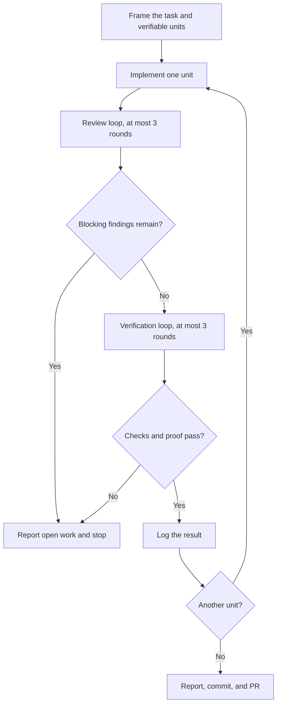

# Run work while you sleep

This is the payoff for everything before it. An agent you can trust to verify its own work is an agent you can leave alone with a hard task. What makes that safe isn't hope. It's a checkable finish condition, an isolated worktree, and a decision log you audit in the morning.

## Earn the trust before the loop

A loop you don't trust just produces unchecked work faster, and the mess compounds with every iteration. Before you leave one running, check that it has earned it:

- You've done the task once by hand, or watched an agent do it, so you know what good looks like.
- The agent has the tools and signals you'd use yourself: the verification skill, the profiler, the logs.
- Every stage proves its work and can stop the line when the work misses the bar.
- You've read a few transcripts and turned the repeated failures into tools, skills, or checks.

Make the loop autonomous only after all four hold. Until then, run it while you watch.

## The overnight contract

A good handoff has the goal, the finish condition, and an escape hatch. It doesn't need to be long:

```text
/fly im going to bed. migrate every caller to the new parser in a fresh worktree off <base>.
done means zero old callers, all parser fixtures pass, old api deleted.
keep a decision log.
/loop until done. if you're truly stuck after a few hours, stop and write up why.
```

Walk through what each line buys you:

- "im going to bed" is a session override. The agent stops asking about reversible work and keeps going. It does not turn on auto mode, so you wake up to an open PR. Start the prompt with `/fly auto` when the run should also merge and deploy.
- "done means..." turns the goal into checks every iteration can run.
- "fresh worktree off `<base>`" keeps the run from colliding with anything else you have open.
- `/loop` is Claude Code's built-in recurring prompt, not a fly skill. In T3 Code, `schedule_task` re-runs a prompt on an interval, at a fixed time, or on a webhook, and works for Codex threads too. Each run keeps the same finish condition and respects the ask-first list.
- The escape hatch lets it stop at a genuine dead end and write up why, which beats eight hours of creative goal reinterpretation.

Long code work uses [Build](../../skills/fly/playbooks/build.md). It frames the task, splits it into verifiable units, and keeps a decision log. Each unit runs the implementation, review, and verification steps. Each loop stops after three rounds if findings remain open.

To stop a run, tell the agent to pause and record the current state and open work. A fresh thread can read that note and the decision log, then frame the next unit. A checkpoint commit needs no approval.

## What the loop does all night



The finish condition stays fixed. A unit ends with evidence, and the log records decisions that changed the work. The run commits, pushes, and opens PRs on its own. Anything behind a gate in the Autonomy section of [`fly`](../../skills/fly/SKILL.md) waits for you.

## The morning audit

[`/show-me-your-work`](../../skills/show-me-your-work/SKILL.md) is what makes the run reviewable. Each row records the time, phase, decision, reason, an evidence pointer, and the result, in a TSV at `decisions.tsv` (or `.audit/<task-slug>.tsv` when several runs share a directory). It stays local by default. Commit it when the work is ambitious enough that a reviewer needs the trail to trust the result.

When you're back, ask for the run in review form:

```text
/show-me-your-work catch me up on what you did last night
```

Before the skill hands back its summary, it spawns a reviewer on a different model family to read the trail and the transcript, and the reply ends with an Attention section listing what deserves your scrutiny. Read that section first, then the log rows it points at. You're auditing decisions, not re-reading the whole night.

## Let loops start themselves

An unattended Build run still waits for you to start it. A scheduled or event-driven task removes that step. Software maintenance splits into stages that suit this well: triage a report, reproduce it, fix it, verify the fix. Two rules keep such a line trustworthy:

- Every stage can stop the line. Triage can decide the report is expected behavior, repro can fail to reproduce it, and the fixer can judge the change too risky. Each of those outcomes is useful, because it keeps bad work from reaching the next stage, where it costs more to undo.
- Every stage hands over evidence. Repro attaches screenshots and video of the broken state, and the fix attaches before-and-after proof. A human can then check that the agent fixed the right thing before reading a line of code.

In T3 Code, `schedule_task` runs a prompt on an interval, at a fixed time, or when a webhook fires, so a triage thread can wake on each new report and a repro thread on each confirmed one. Each stage is its own thread with its own worktree, and a stage that prepares a fix opens the PR and stops there. A scheduled run merges only when its prompt asks for the merge, as in "land the stack", or starts with `/fly auto`.

**Pitfall:** a duration is not a finish condition. "work on this for 4 hours" gives the agent nothing to check, and you'll wake up to four hours of motion instead of a result. Give `/loop` or `schedule_task` a predicate that can pass or fail.

Next: [Steer with principle names](./08-principles.md).
